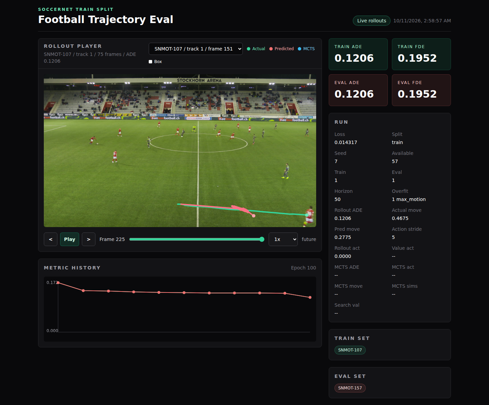
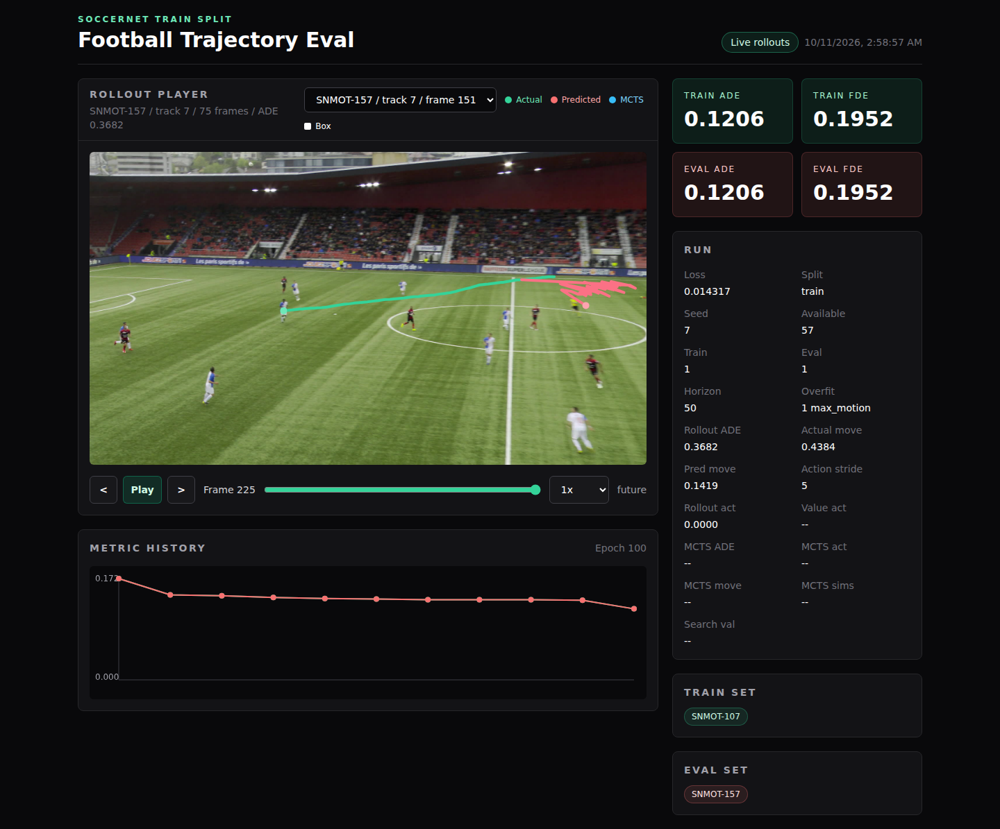

# RL Trainer

## Status: archived — never finished

This project was never finished and is no longer actively developed or maintained.
The repository is archived for reference. The code, plans, and commands below
capture the unfinished experiment and do not represent a completed end-to-end
RL training system.

## Where it got to

The project reached an experimental single-player movement prediction and
visualization loop on real SoccerNet Tracking footage:

- SoccerNet frame-window loading, player boxes, and future movement targets.
- Qwen2-VL features, trainable football heads, supervised training on Modal,
  and checkpoint/metric/rollout artifacts.
- Discrete movement actions, a learned imitation-value head, and MCTS search.
- A browser visualizer with sequence selection, frame playback, actual versus
  predicted paths, optional MCTS overlays, and training metric history.

The saved Modal artifacts also contain a later chunk-policy experiment with
Qwen visual-backbone training enabled, motion baselines, and two example
rollouts. These artifacts do not record their source commit; they should not
be treated as proof that every experiment is reproducible from `main`.

The last saved history ends at epoch 100, using seed 7, one high-motion training
sample from `SNMOT-107`, 25 input frames, and a 50-frame (two-second) prediction
horizon. Training ADE decreased from 0.1720 to 0.1206, and FDE from 0.4365 to
0.1952. The separate `SNMOT-157` rollout did worse than constant velocity:

| Saved rollout | Model ADE | Model FDE | Constant-velocity ADE | Constant-velocity FDE |
| --- | ---: | ---: | ---: | ---: |
| Training example: SNMOT-107 | 0.1206 | 0.1952 | 0.1767 | 0.4423 |
| Separate sequence: SNMOT-157 | 0.3682 | 0.5428 | 0.1765 | 0.3148 |

These errors use image-normalized coordinates, not pitch meters. This was a
one-sample overfit experiment, not a validated generalization result. The
dashboard's Train/Eval cards repeat the overfit sample's metrics; the separate
sequence's result is in its rollout metrics. MCTS was disabled in this saved
run. See the [saved run summary](docs/archive-run-summary.json) for the source
values.

The work stopped before a reliable held-out benchmark, pitch-calibrated
movement prediction, tactical reward learning, full RL post-training, or the
intended multi-player football advisor was completed. The
[implementation plan](docs/football_rl_implementation_plan.md) records the
remaining roadmap rather than completed milestones.

## App screenshots

Screenshots of the repository's visualizer running locally against the saved
Modal artifacts and original match frames. For capture, the newer history
artifact's `history` wrapper was unpacked for the older viewer; metric values
and trajectories were not changed. The hosted app is no longer deployed.

**Training example:** actual movement in green and predicted movement in red,
with the saved run's metric history and final frame selected.



**Separate sequence:** the prediction diverges from the actual movement,
illustrating the unfinished model's generalization problem. The Train/Eval
cards still describe the overfit sample; Rollout ADE describes this sequence.



## Original project overview

This was an experiment repository with the goal of demonstrating end-to-end RL training of an LLM for a specific task.

The task in question is understanding a set of images from a football match and predicting or advising players next moves.

The moves are then overlayed onto the result of the game.

This starts with one player.

See [docs/training_plan.md](docs/training_plan.md) for the historical working plan
and minimal initial training goal. See
[docs/football_rl_implementation_plan.md](docs/football_rl_implementation_plan.md)
for the tracking-first plan centered on SoccerNet player movement, Modal debug
runs, baselines, visual diagnostics, MCTS, and RL-style post-training.

Initial real-data run: deterministic SoccerNet `train` split sequence subsets
with seed `7`, using `10%` of sequences for training and `2%` for held-out eval.
The run writes `sequence_manifest.json`, `training_history.json`,
`trajectory_head.pt`, `trajectory_preview.png`, and `trajectory_rollouts.json`.

Run the first 10%/2% Modal job with:

```bash
uvx modal run modal_train.py --split train --train-fraction 0.10 --eval-fraction 0.02 --seed 7 --epochs 1
```

Artifacts are copied to the `soccernet-tracking` Modal volume, including
`trajectory_rollouts.json` for selectable frame-by-frame playback and
`trajectory_preview.png` for a visual predicted-vs-actual overlay.

Serve the visualizer locally through Modal with:

```bash
uvx modal serve modal_visualize.py
```

Deploy the hosted visualizer with:

```bash
uvx modal deploy modal_visualize.py
```

## Developer checks

Install the commit hooks with:

```bash
uv tool install pre-commit==4.6.0
pre-commit install
```

Run the full local check suite with:

```bash
pre-commit run --all-files
```

The hooks run `ruff check --fix` and `ruff format` before commits. Ruff also
flags unused imports, unused local variables, and unused unpacked variables.

The last documented one-sample learned-value MCTS overfit gate command was:

```bash
uvx modal run modal_train.py --split train --train-sequence-count 1 --eval-sequence-count 1 --input-frames 5 --horizon 50 --action-stride 5 --stride 25 --max-frames 250 --overfit-samples 1 --sample-selection max_motion --epochs 200 --batch-size 1 --lr 0.003 --cache-visual-features --feature-cache-batch-size 1 --policy-loss-weight 1.0 --value-loss-weight 1.0 --value-rank-loss-weight 1.0 --value-fde-weight 0.5 --value-target-scale 10.0 --mcts-simulations 192 --mcts-top-k 10 --mcts-c-puct 1.5 --seed 7
```
